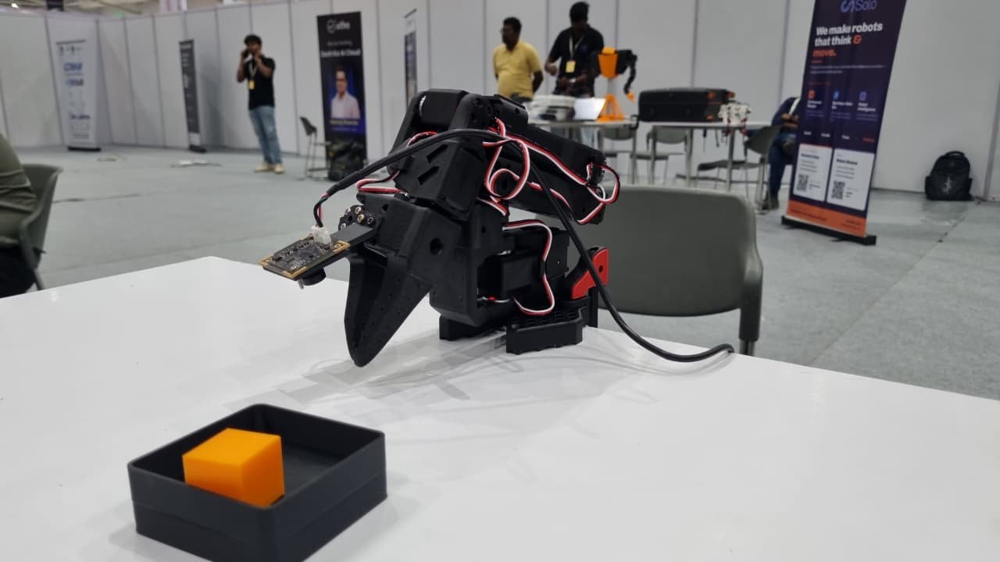

# Team Fractal — SO-101 Sim-to-Real ACT Manipulation (`Prototype`)

**Team:** Chandrashekhar Paliwal & Pratham Mehta  
**Event:** Bharat1.ai × NWaves SO-101 Sim-to-Real Buildathon (Stage 2 Finalist — BIEC Bengaluru, 18 Nov 2026)  
**Designation:** Research & Engineering **Prototype**  
**Jury Hand-In Summary (PDF):** [`Team_Fractal_Jury_Summary.pdf`](./Team_Fractal_Jury_Summary.pdf)

> **Explicit Platform & Open-Source Attribution:**  
> This **Prototype** is built upon and credits **Hugging Face LeRobot 0.4.4** (Action Chunking with Transformers policy architecture & normalizer pipeline), **NVIDIA Isaac Lab** (USD domain-randomized simulation data engine & multi-seed evaluator), and the **NWaves Platform** (`nwaves-train`, `nwaves-eval`, `nwaves-realdata`, and **My Robot** real-arm execution).



---

## 1. Problem
Executing reliable autonomous 30 Hz (`< 33 ms/step`) RGB-only 6-DoF tabletop pick-and-place (`"Put the cube on the tray."`) on physical **Feetech STS3215** servos from dual UVC cameras (`0.52 m` overhead `scene` + `wrist` camera, `640×480 @ 30 fps`) across:
- Arbitrary bright cube colours and randomized spawn/tray poses without depth sensors.
- Camera mount tolerances, wrist PCB camera distortion, and millimetre-level table/tray offsets.
- Preventing catastrophic forgetting of multi-colour priors when adapting to small real-arm teleop datasets.

---

## 2. Technical Approach

### A. NVIDIA Isaac Lab Data Engine (`600` Curated Episodes)
- Procedural trajectory generation (`scripts/generate.py`, `configs/datagen.yaml`) enforcing **24–32 mm vertical tray wall clearance**, randomized bright cube colours, lighting intensity/temperature, camera pose perturbations, and zero hover hesitation at release.
- Achieved **#1 Stage-1 Simulation Score (`10 / 10`, `5.8 s` mean completion time)**.

### B. Forgetting-Safe Sim + Real Co-Training (`Hugging Face LeRobot 0.4.4`)
- Warm-started from our Stage-1 ACT checkpoint (`35,000` steps, `batch_size=8`) and co-trained simulated episodes alongside calibrated real-arm demonstrations (`observation.images.scene`, `observation.images.wrist`, `observation.state [6]`, `action [6]`).
- Verified multi-colour retention in simulation (`nwaves-eval`) prior to submission (`nwaves-submit`).

### C. Hardware-Safe Execution (`policy/policy.py`)
- Open-loop action chunk execution (`n_action_steps=25`) with non-snapping compliant gripper bounds (`[6.0, 58.0]`, `snap_gripper=False`) to prevent STS3215 current-overload stalls and cube bounce on release.

---

## 3. Repository Structure

```text
fractall/
├── Team_Fractal_Jury_Summary.pdf   # 1-Page Printable A4 Jury Hand-In (Prototype)
├── Team_Fractal_Jury_Summary.html  # Source A4 layout
├── biec_so101_real.jpg             # Physical SO-101 setup at BIEC Bengaluru
├── configs/
│   └── datagen.yaml                # NVIDIA Isaac Lab domain randomization config
├── nwaves_hackathon/               # Task environment, IK, tray geometry, randomizer & policy server
├── policy/
│   ├── policy.py                   # Stage-2 ACT runtime wrapper (cuda -> mps -> cpu)
│   ├── config.json                 # LeRobot 0.4.4 ACT architecture config
│   ├── inference.json              # Chunking & safe physical gripper bounds
│   ├── policy_preprocessor.json    # State/visual normalizer pipeline config
│   └── policy_postprocessor.json   # Action unnormalizer pipeline config
└── scripts/
    ├── generate.py                 # 600-episode trajectory-shaped Isaac Lab generator
    ├── evaluate.py                 # Multi-seed simulation evaluator
    ├── teleop.py                   # Leader-follower / keyboard teleoperation recorder
    ├── to_lerobot.py               # Episode converter to LeRobot v3.0 dataset format
    └── pack_stage2_real.py         # Validator-clean checkpoint packager & smoke tester
```

---

## 4. Reproducing Data Generation, Training & Evaluation

```bash
# 1. Generate domain-randomized simulation episodes in NVIDIA Isaac Lab
isaaclab -p scripts/generate.py --episodes 600 --config configs/datagen.yaml --name sim_pickplace_v2
nwaves-dataset sim_pickplace_v2 ppprock11/so101_pickplace_training_v2

# 2. Train / Co-Train ACT Policy (Hugging Face LeRobot 0.4.4)
nwaves-train ppprock11/so101_pickplace_training_v2 --policy act --steps 35000 --batch 8 --name best_success_35k_original

# 3. Continue training on normalized BIEC real-arm demonstrations
lerobot-train \
  --policy.path=/home/user/workspace/outputs/best_success_35k_original/checkpoints/last/pretrained_model \
  --dataset.repo_id=cspaliwal/so101_real_finetune_v5_scene \
  --dataset.root=/home/user/workspace/lerobot_datasets/v5_scene \
  --policy.device=cuda --policy.push_to_hub=false \
  --steps=3000 --batch_size=8 --save_freq=3000 \
  --output_dir=/home/user/workspace/outputs/act_35k_v5_fixed

# 4. Evaluate in simulation & submit to NWaves My Policies
nwaves-eval --policy /home/user/workspace/outputs/act_35k_v5_fixed
nwaves-submit /home/user/workspace/outputs/act_35k_v5_fixed
```

---

## 5. Results & Honest Prototype Limits

| Benchmark | Result | Mean Time |
|---|---|---|
| **Stage-1 Simulation (`nwaves-eval` / Official Leaderboard)** | **`10 / 10`** (#1 Seed Rank) | **`5.8 s`** |
| **Inference Latency (`policy/policy.py`, 25-step chunk)** | **`< 23 ms`** (GPU) | **`30 Hz`** |

### Honest Engineering Limits
1. **0.52 m Scene Camera Extrinsics Sensitivity:** Monocular RGB depth inference degrades if the overhead camera mount shifts `> 1 cm` relative to the calibrated tabletop before wrist-camera acquisition.
2. **Physical STS3215 Backlash & Thermal Cutoff (`> 60°C`):** `~1.2°` servo gear play and continuous-load heating require compliant grasp limits and brief cooling intervals.
3. **UVC Auto-Exposure Swings:** Overhead venue spotlights reflecting off glossy PLA cube faces or white tabletop surfaces induce hardware auto-exposure shifts.

---

## 6. Model Weights & Datasets on Hugging Face
- **Stage-1 Base Checkpoint (`35k`):** [`ppprock11/so101_best_success`](https://huggingface.co/ppprock11/so101_best_success)
- **Stage-2 Checkpoints & Packager:** [`cspaliwal/so101-stage2-deploy`](https://huggingface.co/cspaliwal/so101-stage2-deploy)
- **Stage-2 Normalized Real Dataset (`scene` + `wrist`, `so101_follower`):** [`cspaliwal/so101_real_finetune_v5_scene`](https://huggingface.co/datasets/cspaliwal/so101_real_finetune_v5_scene)
